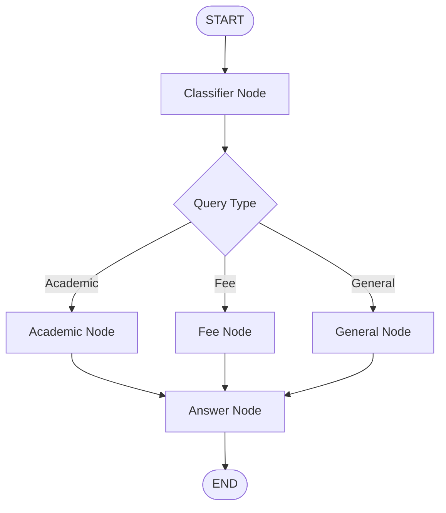

# 🎓 EduQuery – AI-Powered University Query Assistant

EduQuery is an AI-powered university query assistant built using **LangGraph, LangChain, RAG (Retrieval-Augmented Generation), and Streamlit**. It helps students get accurate answers to university-related questions by retrieving relevant information from official PDF documents.

The application intelligently classifies user queries and routes them to specialized processing nodes for academic, fee-related, or general questions.

## ✨ Features

- **Intelligent Query Classification:** Automatically identifies the type of student query.
- **LangGraph Workflow:** Uses a state-based graph with conditional routing.
- **Academic Information:** Answers academic questions using university handbook PDFs.
- **Fee Information:** Retrieves fee-related details from university documents.
- **RAG Pipeline:** Retrieves relevant document context before generating answers.
- **General Query Handling:** Handles general questions without unnecessary document retrieval.
- **Context-Aware Responses:** Uses retrieved information to generate relevant answers.
- **Streamlit Interface:** Provides an interactive interface for students.

## 🛠️ Tech Stack

| Technology | Purpose |
|---|---|
| Python 3.12 | Core programming language |
| LangGraph | Workflow orchestration |
| LangChain | LLM and retrieval integration |
| Groq | LLM inference |
| HuggingFace | Text embeddings |
| FAISS | Vector similarity search |
| PyPDF | PDF document loading |
| Streamlit | User interface |
| UV | Python environment and dependency management |

## 🏗️ Project Architecture

```text
EduQuery/
│
├── app/
│   ├── llm.py
│   ├── state.py
│   ├── nodes.py
│   └── graph.py
│
├── retriever/
│   └── retriever.py
│
├── data/
│   ├── academics_handbook.pdf
│   └── fee_structure.pdf
│
├── main.py
├── requirements.txt
├── .gitignore
└── README.md
```

## 🔄 LangGraph Workflow

EduQuery uses a conditional LangGraph workflow to process student queries.



### Workflow Explanation

1. **Classifier Node:** Analyzes the user's question and identifies its category.
2. **Academic Node:** Retrieves relevant academic information from university documents.
3. **Fee Node:** Retrieves relevant fee information from fee structure documents.
4. **General Node:** Handles general questions that do not require document retrieval.
5. **Answer Node:** Generates the final response using the available context.

## ⚙️ Installation & Setup

### 1. Clone the Repository

```bash
git clone https://github.com/azaan03/EduQuery.git
cd EduQuery
```

### 2. Create Virtual Environment

Using UV:

```bash
uv venv
```

Activate on Windows PowerShell:

```powershell
.venv\Scripts\Activate.ps1
```

### 3. Install Dependencies

```bash
uv pip install -r requirements.txt
```

### 4. Configure Environment Variables

Create a `.env` file in the project root:

```env
GROQ_API_KEY=your_groq_api_key
```

Add your Groq API key to access the language model.

### 5. Add University Documents

Place the required university PDF documents inside the `data/` directory.

### 6. Run the Application

```bash
streamlit run main.py
```

The application will open in your browser.

## 🔐 Environment Variables

| Variable | Description |
|---|---|
| `GROQ_API_KEY` | API key for Groq LLM inference |

**Important:** Never upload your `.env` file or API keys to GitHub.

## 🎯 Project Objective

The primary objective of EduQuery is to simplify access to university information through an intelligent conversational interface.

Instead of manually searching through lengthy PDF documents, students can ask questions in natural language and receive answers based on relevant university information.

## 👨‍💻 Developer

**Azaan Farooqi**

AI Engineer | Python | LangChain | LangGraph | RAG | Generative AI

GitHub: [@azaan03](https://github.com/azaan03)

---

*EduQuery – Making University Information Accessible Through AI.*
